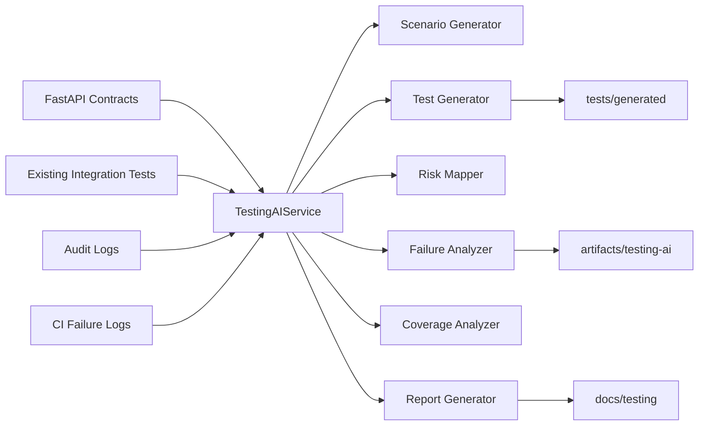
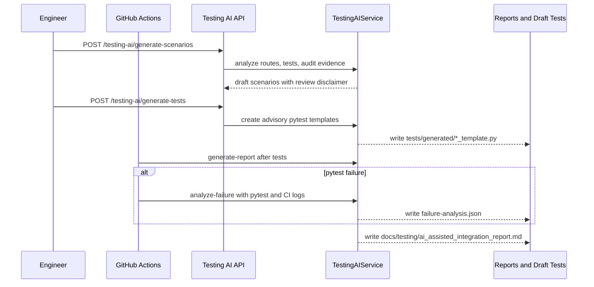

# Clinical Insights AI

> Engineering reference implementation for a clinical-document RAG system with evidence-grounded answers, refusal behavior, audit metadata, and review-oriented quality checks.

> Scope, non-claims, and data-handling limits are defined in [DISCLAIMER.md](DISCLAIMER.md).

## What I'd Do Next In Production

1. Replace demo/local retrieval with production PGVector-only serving and regional failover.
2. Add centralized immutable audit storage plus retention/forensics controls.
3. Introduce SLO-backed alerting and on-call playbooks tied to safety and refusal metrics.
4. Run formal PHI data-flow review and security hardening before any real clinical data.
5. Execute clinician-led validation on representative use cases before broader rollout.

## Why This Repository Exists

Clinical and operational documents are often long and difficult to search. This project demonstrates a safer document Q&A flow:

1. retrieve evidence first,
2. decide whether evidence quality is sufficient,
3. answer with citations or refuse/clarify,
4. persist reviewable audit metadata.

The repository is designed for technical-review walkthroughs of engineering quality in an AI system.

## Quick Review Links

- Reviewer guide (5-minute path): [docs/reviewer_guide.md](docs/reviewer_guide.md)
- Evaluation docs: [docs/evaluation.md](docs/evaluation.md)
- CI workflow: [.github/workflows/ci.yml](.github/workflows/ci.yml)
- Container workflow: [.github/workflows/cd.yml](.github/workflows/cd.yml)
- Architecture overview: [docs/architecture.md](docs/architecture.md)
- Architecture deep dive index: [docs/architecture/README.md](docs/architecture/README.md)
- Engineering tradeoffs: [docs/engineering_tradeoffs.md](docs/engineering_tradeoffs.md)
- Refusal logic: [backend/refusal/logic.py](backend/refusal/logic.py)
- Safety decision orchestration: [backend/safety/decision_engine.py](backend/safety/decision_engine.py)
- Query orchestration: [backend/services/query_service.py](backend/services/query_service.py)
- Audit logging service: [backend/services/audit_service.py](backend/services/audit_service.py)
- JSONL audit writer: [backend/audit/jsonl_writer.py](backend/audit/jsonl_writer.py)
- Benchmark script: [scripts/benchmark_api.py](scripts/benchmark_api.py)
- Load-test script: [tests/load/k6_smoke.js](tests/load/k6_smoke.js)

## Demo

- Video: [docs/demo/demo.mp4](docs/demo/demo.mp4)
- Preview image: [docs/demo/demo-preview.png](docs/demo/demo-preview.png)
- Screenshot walk-through: [docs/demo/README.md](docs/demo/README.md)

## Measurable Outcomes (Current Deterministic Baseline)

Last run: 2026-07-10 (local deterministic harnesses)

| Metric area | Metric | Current result | Source |
|---|---|---:|---|
| Latency | Average retrieval latency | 0.032 ms | `evals/retrieval_eval.py` |
| Eval quality | Top-1 retrieval accuracy | 100.00% (8/8) | `evals/retrieval_eval.py` |
| Eval quality | Top-3 retrieval accuracy | 100.00% (8/8) | `evals/retrieval_eval.py` |
| Failure rates | Missing evidence cases in retrieval eval | 0 | `evals/retrieval_eval.py` |
| Guardrail coverage | Refusal/adversarial pass rate | 100.00% (9/9) | `evals/refusal_eval.py` |
| Failure rates | Refusal eval failed cases | 0 | `evals/refusal_eval.py` |

Notes:
- These are engineering baseline signals from deterministic local evaluations, not clinical-performance claims.
- CI also enforces lint, tests, type checks, and coverage gates in [.github/workflows/ci.yml](.github/workflows/ci.yml).

## Core Capabilities

- Upload PDF/TXT clinical documents and index chunked text for retrieval.
- Generate evidence-grounded answers with citation metadata.
- Refuse or clarify when evidence is missing, weak, contradictory, or unsafe.
- Record query metadata for reviewability and audit trails.
- Run deterministic local evaluation for retrieval and refusal behavior.

## AI-Assisted Integration Testing

The repository now includes an advisory integration-testing framework that analyzes API contracts, existing tests, audit evidence, and CI failures to propose new high-risk scenarios and draft pytest templates.

All outputs are draft-only. The framework never auto-approves tests, never overwrites existing tests, and requires explicit human review before any generated artifact is enabled.

### Feature Overview

- Analyzes FastAPI endpoint contracts and existing pytest coverage signals.
- Maps requirements to system behavior, risk, integration test intent, expected result, and evidence to collect.
- Produces structured JSON for failure triage and traceability.
- Generates non-destructive pytest templates under `tests/generated/` with review banners and `pytest.mark.skip` guards.
- Writes an advisory Markdown coverage report to `docs/testing/ai_assisted_integration_report.md`.
- Persists a Mermaid integration graph at `docs/testing/integration_test_graph.mmd`.
- Computes risk coverage scores for engineering dashboard-style review.

### Architecture Diagram



### Sequence Diagram



### Integration Test Graph

The generated report now embeds a deterministic traceability graph and also writes the Mermaid source to `docs/testing/integration_test_graph.mmd` so reviewers can inspect the chain from requirement to audit evidence and the runtime path from API to response.

### Risk Coverage Score

The report computes category-level risk coverage scores to show where integration assurance is strongest and where gaps remain. Current categories include Evidence Retrieval, Safety Rules, Audit Logging, Failure Recovery, Configuration, Document Ingestion, and Prompt Injection.

### Example Workflow

1. Call `POST /testing-ai/generate-scenarios` to inspect current endpoint and integration-test coverage.
2. Review the structured gaps and select scenarios that matter for the next change.
3. Call `POST /testing-ai/generate-tests` to create draft pytest templates under `tests/generated/`.
4. Manually review, edit, and promote selected drafts into executable test suites.
5. Let CI publish the updated Markdown report and, on failures, a non-blocking advisory failure analysis.

### Human Review Process

1. Review every generated scenario for correctness, safety relevance, and business fit.
2. Validate every generated pytest draft before renaming or executing it.
3. Confirm the traceability map links the intended requirement, risk, and evidence set.
4. Treat CI failure analysis as debugging support, not as an approval or root-cause authority.

### Limitations

- Current analysis is deterministic and heuristic-driven rather than based on a live LLM call.
- Coverage inference is approximate and based on route and keyword signals in current tests.
- Generated pytest files are scaffolds, not ready-to-run production tests.
- Failure analysis confidence is advisory and should be validated against raw logs.

### Security Considerations

- Generated outputs are explicitly non-authoritative and require human validation.
- No generated file is allowed to overwrite an existing test.
- CI analysis steps are non-blocking so advisory tooling cannot mask or replace the real pytest result.
- The framework does not alter the RAG pipeline or existing response behavior.

## Run Locally

### API (local Python)

```bash
python -m venv .venv
source .venv/bin/activate
pip install -r requirements.txt
scripts/run_local.sh
```

Open: `http://localhost:8000/docs`

### Docker Compose

```bash
cp .env.example .env
scripts/deploy_local.sh
curl http://localhost:8000/health
```

## Quality Checks

```bash
make lint
make test
make eval
make smoke-test
```

## Evaluation

Deterministic local harnesses are documented in [docs/evaluation.md](docs/evaluation.md).

```bash
make eval-retrieval
make eval-refusal
make eval
```

## Performance Evidence

How to generate local performance evidence:

1. Start the API (`scripts/run_local.sh` or `scripts/deploy_local.sh`).
2. Run latency benchmark:

```bash
python3 scripts/benchmark_api.py --url http://localhost:8000/health --requests 100 --warmup 10 --save-json
```

3. Run smoke load test:

```bash
k6 run tests/load/k6_smoke.js
```

## CI/CD

- Main quality gates: [.github/workflows/ci.yml](.github/workflows/ci.yml)
- Container release workflow: [.github/workflows/cd.yml](.github/workflows/cd.yml)

CI checks are engineering evidence of repeatable validation and are not clinical validation.

## Additional Documentation

- Reviewer guide: [docs/reviewer_guide.md](docs/reviewer_guide.md)
- Evaluation: [docs/evaluation.md](docs/evaluation.md)
- Architecture docs: [docs/architecture/README.md](docs/architecture/README.md)
- Engineering tradeoffs: [docs/engineering_tradeoffs.md](docs/engineering_tradeoffs.md)
- ADR index: [docs/adr/README.md](docs/adr/README.md)
- Observability notes: [docs/runbooks/observability_playbook_lite.md](docs/runbooks/observability_playbook_lite.md)

## Limitations and Non-Claims

- Not clinically validated and not intended for diagnosis, treatment, or triage.
- Not HIPAA-compliant as delivered.
- Not FDA-cleared and not a medical device.
- Confidence scores are retrieval heuristics, not calibrated correctness probabilities.
- Evaluation results are engineering evidence of repository controls, not clinical evidence.
