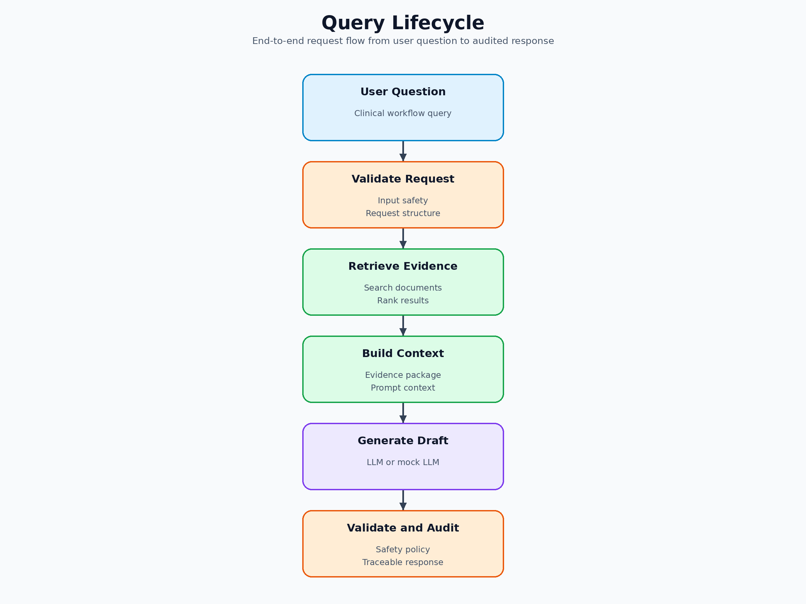

# Architecture

Clinical Insights AI is a small clinical-document RAG application. The main design choice is to keep answer generation behind retrieval, evidence checks, citation checks, and safety decisions.

> This project is a demonstration only. It is not a medical device and must not be used for clinical decision-making.

## Runtime Flow

## Backend Responsibilities

- `backend/api/`: HTTP routes and response models.
- `backend/services/`: workflow orchestration for documents, queries, audit, and review.
- `backend/rag/`: chunking, embedding, retrieval, and generation adapters.
- `backend/safety/`: input, evidence, citation, and output checks.
- `backend/refusal/`: retrieval threshold and refusal logic.
- `backend/audit/`: JSONL audit helpers and audit search utilities.
- `backend/models/` and `backend/schemas/`: persistence models and API contracts.

## Operational Responsibilities

- `config/`: non-secret runtime defaults.
- `scripts/`: local run, test, build, smoke, and deploy helpers.
- `Dockerfile` and `docker-compose.yml`: local container runtime.
- `.github/workflows/ci.yml`: lint, tests, coverage, security, build, and smoke checks.

## Notes

- `confidence_score` is a retrieval heuristic, not a probability of correctness.
- Query audit metadata supports review, not deterministic replay.
- Mock LLM mode supports local checks without external provider credentials.
- Additional diagrams live under [docs/architecture/](architecture/README.md) for readers who want more detail.
