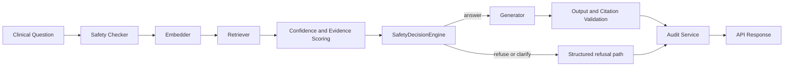

# AI Architecture

## Purpose

This view explains how a clinical question becomes a grounded answer, and how the system refuses weak or unsafe requests.

## Diagram

## What the Implementation Actually Does

- `backend/api/query.py` and `backend/api/ask.py` screen input through the safety checker before the RAG pipeline runs.
- `backend/services/query_service.py` performs the core orchestration: embed, retrieve, score confidence, decide whether to answer, and write audit data when configured.
- `backend/refusal/logic.py` derives evidence status from retrieval results and YAML threshold rules.
- `backend/safety/decision_engine.py` converts evidence and output checks into a deterministic safety decision.
- `backend/rag/generator.py` produces answers only when the downstream decision path allows it.
- `backend/services/query_service.py` falls back to fake or mock generation when the configuration says to run in demo mode or when the provider is unavailable.

## Engineering Rationale

The AI layer is not a single prompt and model call. It is a sequence of checks that decides whether generation is even allowed. That prevents the model from becoming the source of truth when the evidence is weak.

Confidence note: `confidence_score` is a similarity-based retrieval heuristic from `backend/evaluation/scorer.py`. It is not a calibrated probability of correctness.

## Systems Engineering Principle

The design is evidence-first and fail-closed. Retrieval confidence, evidence status, and safety decision all have to align before an answer is allowed to leave the system.

## Scalability

- Retrieval is separated from generation, so the system can evolve the vector store or model provider independently.
- Mock LLM mode keeps local demos and CI deterministic.
- Threshold logic is driven by configuration and YAML rules instead of hard-coded one-off branches.

## Maintainability

The pipeline is split into small modules with clear boundaries: embedder, retriever, refusal logic, safety engine, generator, and audit service. That makes each step easy to test and easier to replace.

## Verification Strategy

- Retrieval tests assert sufficient, weak, and missing evidence behavior.
- Safety tests verify refusal and output gating.
- Query service tests prove the LLM is not called when evidence is weak or missing.
- Contract tests verify the response schema still exposes confidence, citations, and evidence metadata.

## Recommendations

- The UI exposes additional provenance metadata that is already available in the response model.
- Expand the evaluation harness to quantify retrieval drift and threshold tuning over time.
