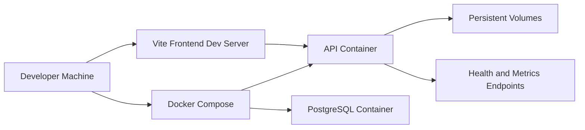

# Deployment Architecture

## Purpose

This view explains how the application is deployed and what actually runs in local development versus Docker Compose.

## Diagram

## What the Implementation Actually Does

- Docker Compose provisions **two** containers: the API service and PostgreSQL.
- The frontend is currently run as a Vite development server during local demo and recording work.
- `MOCK_LLM=true` is used in local demo mode and Compose to keep the experience deterministic.
- The API container exposes health checks and metrics.
- Persistent volumes keep database and application data across restarts.

## Engineering Rationale

The deployment model keeps the runtime simple while showing the API/database container boundary.

## Systems Engineering Principle

The deployment path is explicit about what is running, where it runs, and how readiness is measured. That makes the system inspectable instead of opaque.

## Scalability

- The API can move to a different orchestrator without changing the service contracts.
- The vector store can use local ChromaDB or PGVector without changing the user journey.
- The frontend transitions from local dev to a production static site or container.

## Maintainability

The deployment story is separated from the application code. Compose, Dockerfile, and CI workflow each own one layer of the operational contract.

## Verification Strategy

- Health endpoints verify the API container is ready.
- Compose health checks verify database availability.
- CI validates Docker and deployment script presence.

## Recommendations

- Add a separate frontend container only if the UI needs to be part of the containerized local runtime.
