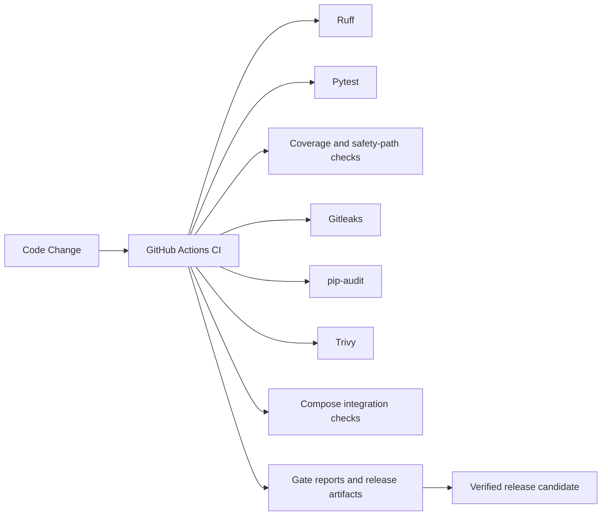

# DevOps Architecture

## Purpose

This view explains how code moves from a developer change to a verified release candidate through deterministic CI/CD gates.

## Diagram

## What the Implementation Actually Does

- `/.github/workflows/ci.yml` defines the gate chain.
- `ruff` enforces style and basic import correctness.
- `pytest` runs the backend tests.
- Coverage is enforced with a backend threshold and a safety-path check.
- Secret scanning uses Gitleaks.
- Dependency scanning uses `pip-audit`.
- Image scanning uses Trivy.
- Compose integration checks that the database container becomes healthy.
- Build and deployment-readiness checks prove the release artifacts are packageable.

## Engineering Rationale

The DevOps path is split into small gates so each concern is visible and failure is localizable. This is easier to reason about than a single monolithic CI job.

## Systems Engineering Principle

The pipeline is deterministic and auditable. Each gate answers a separate question: is the code sound, is the behavior safe, can it be packaged, can it be deployed, and can it be observed.

## Scalability

- Add new gates without changing the application runtime.
- Evolve security and quality checks independently.
- Use the release review artifact as the human-facing summary for a larger pipeline.

## Maintainability

The workflow is explicit in GitHub Actions, and the supporting scripts live under `scripts/`. That keeps the release process reproducible and reviewable.

## Verification Strategy

- Local `make ci-local` reproduces the major gates.
- CI artifacts capture the outcome of each stage.
- Smoke tests and health checks provide fast runtime verification.

## Recommendations

- Add a dedicated frontend service to Compose and a matching production image to fully containerize the frontend.
- Add a C4 deployment diagram as a formal architecture artifact.
