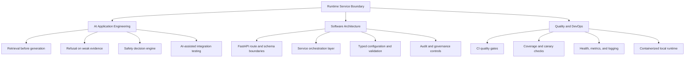

# Engineering Capability Map

## Purpose

This view summarizes what the repository demonstrates across AI application engineering, backend design, and DevOps checks.

## Diagram

## Evidence in Repository Structure

- Systems engineering evidence: `backend/main.py`, `backend/core/bootstrap.py`, `backend/schemas/health.py`.
- AI engineering evidence: `backend/retrieval/`, `backend/services/query_service.py`, `backend/refusal/logic.py`, `backend/safety/decision_engine.py`.
- Software architecture evidence: `backend/api/`, `backend/services/`, `backend/schemas/`, `tests/`.
- DevOps evidence: `Dockerfile`, `docker-compose.yml`, `.github/workflows/ci.yml`, `scripts/test.sh`, `scripts/smoke_test.sh`.

## Engineering Narrative

- The application does not treat model output as inherently trusted.
- Evidence quality determines whether generation is allowed.
- Governance and audit controls provide explicit reviewability.
- CI and runtime checks provide operational confidence.

## Why This Matters

This capability map helps reviewers quickly see that the repository demonstrates maintainable AI application engineering, not just prompt orchestration or UI integration.
