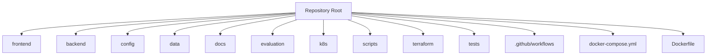

# Repository Architecture

## Purpose

This file explains why each top-level folder exists and how the repository maps to the live implementation.

## Diagram

## Why Each Folder Exists

- **frontend/**: Vite React application for the user experience.
- **backend/**: runtime FastAPI application and domain code.
- **config/**: non-secret YAML defaults for retrieval, models, prompts, and logging.
- **data/**: local persistence, sample documents, and JSONL artifacts.
- **docs/**: architecture, safety, governance, operational, and demo documentation.
- **evaluation/**: CI-oriented retrieval evaluation assets.
- **k8s/**: Kubernetes deployment and health-check manifests.
- **scripts/**: repeatable local run, test, evaluation, and recording automation.
- **terraform/**: infrastructure-as-code for cloud deployment targets.
- **tests/**: regression tests for APIs, services, safety, governance, and retrieval.
- **ui/**: currently empty/legacy in the tree.
- **Dockerfile**: container image build definition for the API service.
- **docker-compose.yml**: local orchestration for API and PostgreSQL.
- **.github/workflows/**: deterministic CI/CD gates and release review artifacts.

## Implementation Notes

- The active frontend flow in `frontend/src/App.tsx` mounts the document workspace.
- The repo also contains reusable dashboard, risk, and traceability views that are not currently mounted in the main app shell.
- The backend package is structured around routers, services, retrieval, safety, governance, audit, and persistence.
- `data/documents.json` is used as a fallback metadata store when the database is unavailable in local development.

## Engineering Rationale

The repository layout mirrors the runtime layers. That makes it easier for reviewers to connect a folder to a responsibility and a test strategy.

## Systems Engineering Principle

This is a traceability-oriented layout. The repo is organized so every change is traceable from documentation to code to tests to deployment.

## Scalability

- Add new backend services without disturbing the frontend structure.
- Add new documentation under `docs/architecture/` without replacing existing narrative docs.
- Add deployment targets through `k8s/` and `terraform/`.

## Maintainability

The current structure separates runtime code, operational code, tests, and documentation. That reduces accidental coupling and makes it easier to locate responsibilities.

## Verification Strategy

- Every folder that matters to runtime behavior has at least one corresponding test or operational artifact.
- CI validates the presence of critical architecture and deployment files.
- Smoke tests and contract tests verify that the repo layout is consistent with the running service.

## Recommendations

- Remove `ui/` if it remains unused, or repurpose it with a clear owner and purpose.
- Keep runtime entry points under `backend/` to avoid launcher ambiguity.
- Use this folder map as the source for C1 through C3 views in a formal C4 artifact set.
