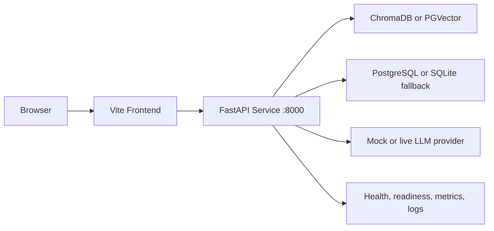

# Runtime Architecture

## Purpose

This view explains how the system behaves at runtime in the implementation that exists today.

## Diagram

## Actual Runtime Characteristics

- The frontend is served locally by Vite during development and video recording.
- The API runs as the FastAPI service on port 8000.
- Docker Compose starts the API and PostgreSQL; the frontend is not currently a Compose service.
- The vector store runs on local ChromaDB or PGVector based on configuration.
- Mock LLM mode keeps the runtime deterministic for demos and local validation.
- Health and readiness endpoints give a clear operational signal.

## Engineering Rationale

The runtime architecture separates presentation, API orchestration, retrieval, generation, governance, and persistence so each layer can fail independently and be diagnosed independently.

## Systems Engineering Principle

The runtime is observable and bounded. Each component has a visible contract, and readiness is checked explicitly rather than assumed.

## Scalability

- The frontend is replaceable without changing backend behavior.
- The retrieval backend scales separately from request handling.
- The LLM provider is swappable through configuration.

## Maintainability

This runtime layout keeps the codebase understandable during demos: browser, frontend, API, retrieval, storage, and observability are distinct responsibilities.

## Verification Strategy

- `GET /health/live`, `GET /health/ready`, and `GET /health` validate runtime status.
- `GET /metrics` validates observability.
- Smoke tests validate application startup and health endpoints.

## Recommendations

- Add a static frontend container or a reverse proxy service to deliver a single-container frontend experience.
- Add a production runtime diagram after deployment target selection is finalized to show environment parity.
