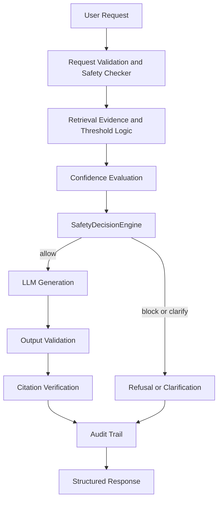

# Safety Architecture

## Purpose

This view explains how the system prevents unsafe or unsupported clinical responses.

## Diagram

## Safety Layers in the Implementation

- **Request validation**: `backend/api/ask.py` and `backend/api/query.py` call the safety checker before the RAG pipeline runs.
- **Retrieval evidence**: `backend/refusal/logic.py` assigns evidence status using similarity thresholds and risk-aware rules.
- **Confidence evaluation**: `backend/evaluation/scorer.py` and `backend/services/query_service.py` compute confidence before generation.
- **LLM gating**: the generator is called only when safety permits it.
- **Output validation**: `backend/safety/output_validation.py` and `backend/safety/citation_verifier.py` validate the answer and citations.
- **Policy engine**: `backend/safety/decision_engine.py` turns evidence and output findings into a deterministic action.
- **Governance rules**: `backend/governance/rule_engine.py` controls advisory draft behavior before output is produced.
- **Audit trail**: `backend/services/audit_service.py` and `backend/audit/jsonl_writer.py` preserve traceability.

## Engineering Rationale

The safety architecture is layered so unsafe content is stopped at multiple points. That reduces the chance that any single check failure leads to an unsupported clinical response.

## Systems Engineering Principle

This is a defense-in-depth design. Validation, retrieval, policy, and audit are separate controls rather than one large safety function.

## Scalability

- Change thresholds through configuration without rewriting control flow.
- Add validation rules to the safety engine.
- Evolve governance policy in YAML while the API contract remains stable.

## Maintainability

Each safety step is individually testable. That makes the behavior easier to understand, modify, and explain.

## Verification Strategy

- Safety tests cover prompt injection, evidence refusal, output validation, and clarification/refusal behavior.
- Query tests verify the generator is not called when the evidence is weak or missing.
- Advisory tests verify governance blocks and invalid-output handling.

## Recommendations

- The response card now exposes provenance metadata, which makes safety decisions easier to inspect during technical reviews.
- Build a separate dashboard that visualizes refusal rates and confidence distribution over time.
