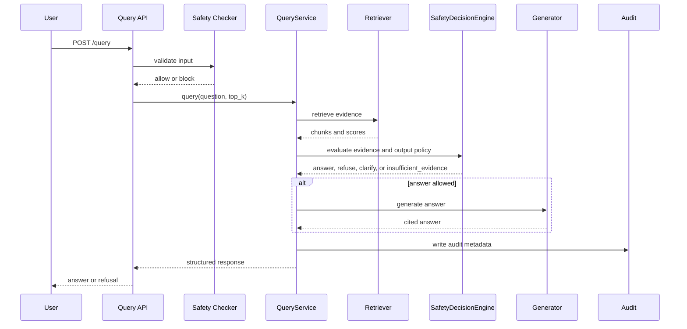
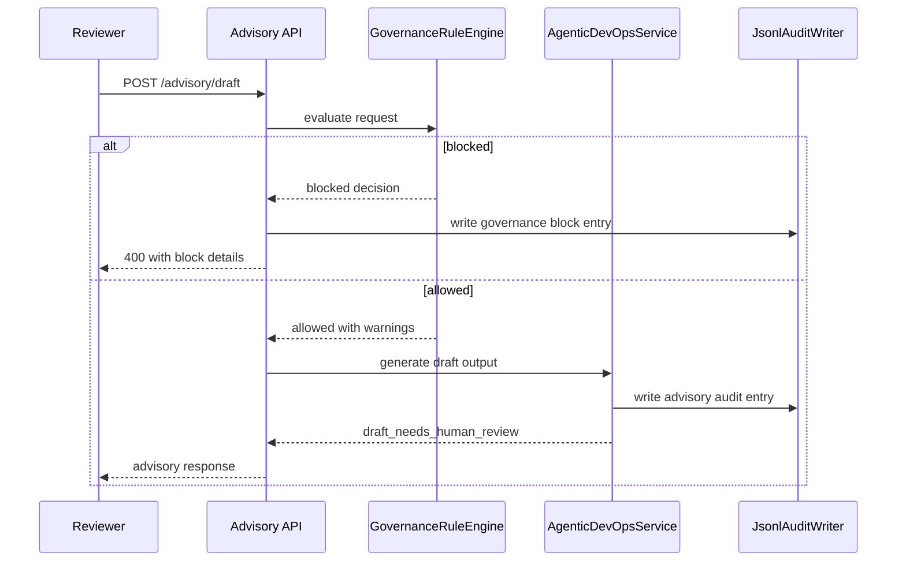

# Sequence Diagrams

## Purpose

This file shows how requests move through the system for a clinical question and for governed advisory automation.

## Clinical Question Sequence

## Advisory Draft Sequence

## Engineering Rationale

The sequence shows that input safety, retrieval confidence heuristics, generation, output validation, and audit logging are separate decisions. That gives reviewers a concrete story for how the platform behaves under both success and refusal paths.

## Systems Engineering Principle

The design is explicit about state transitions. A request is never allowed to skip from user input to trusted answer without intermediate checks.

## Scalability

- The flow supports additional decision branches without changing the client contract.
- Advisory automation remains separate from clinical Q&A.
- The same sequence works with mock generation and live LLM providers.

## Maintainability

Sequence diagrams are kept separate from code so the walkthrough can evolve independently of implementation.

## Verification Strategy

- API and service tests verify the same control flow.
- Refusal and governance tests validate the blocked branches.
- Smoke tests verify the happy-path startup and response cycle.

## Recommendations

- Add a second sequence diagram for document upload and indexing.
- Use this file as the runtime interaction view in the C4 package.
