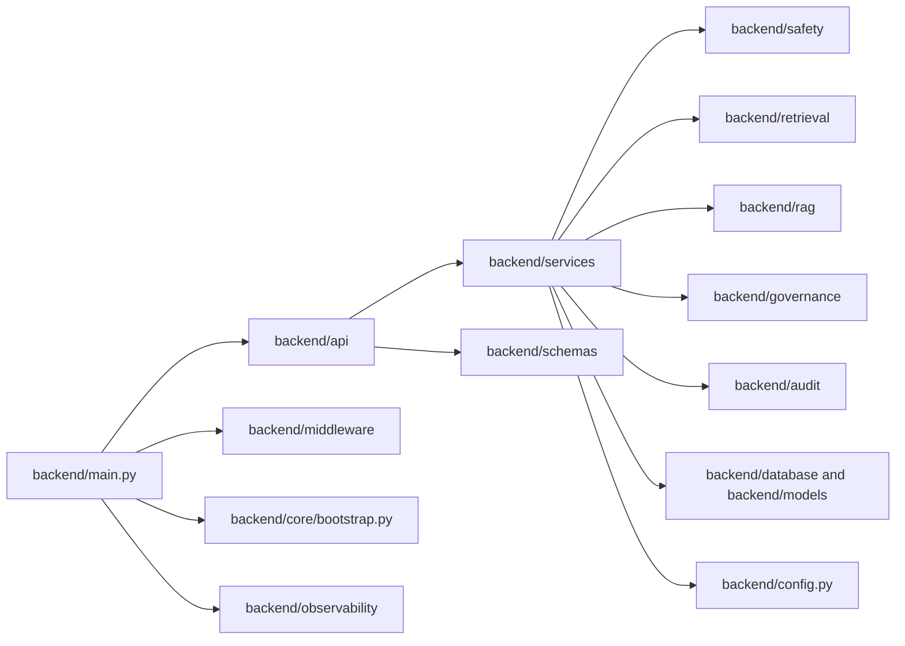

# Software Architecture

## Purpose

This view explains how the backend is decomposed into routers, services, retrieval, safety, governance, audit, persistence, and operational support code.

## Diagram

## Module Responsibilities

- **backend/main.py**: assembles the app, middleware, routers, metrics, and health endpoints.
- **backend/api/**: HTTP boundaries only. Each router translates request/response contracts into service calls.
- **backend/services/**: owns the application workflow logic.
- **backend/rag/** and **backend/retrieval/**: chunking, embeddings, retrieval, and sync/reconciliation behavior.
- **backend/safety/**: evidence validation, output validation, prompt injection checks, and safety decisions.
- **backend/governance/**: YAML-backed rule evaluation for controlled automation and policy enforcement.
- **backend/audit/**: append-only audit trail writing and search.
- **backend/database/** and **backend/models/**: persistence and ORM boundaries.
- **backend/core/**: runtime bootstrap and readiness wiring.
- **backend/observability/**: metrics and request observability.
- **backend/middleware/**: cross-cutting request security and throttling.
- **backend/config.py**: central configuration and environment validation.

## Engineering Rationale

The repository follows a layered architecture so each concern is testable and replaceable independently. Routers are intentionally thin; services coordinate behavior; AI and persistence live behind explicit dependencies.

## Systems Engineering Principle

The design minimizes coupling and keeps the boundary between transport, policy, AI reasoning, and persistence clear. This reduces accidental complexity and makes failure modes visible.

## Scalability

- Add routers without rewriting the service layer.
- Change the retrieval backend without changing route contracts.
- Swap or extend the audit layer independently.
- Evolve the frontend while keeping the same API contracts.

## Maintainability

The architecture maps directly to the folder layout. That makes it easy for reviewers to locate the code responsible for a given runtime behavior.

## Verification Strategy

- Router tests verify API contracts.
- Service tests verify orchestration and failure handling.
- Safety and governance tests verify refusal and policy behavior.
- Database and audit tests verify persistence behavior.

## Recommendations

- The repository already contains reusable dashboard, risk, and traceability components in `frontend/src/views/`; expose them explicitly through router/state wiring in the demo flow.
- Use this file as the C3 component view in the full C4 package.
