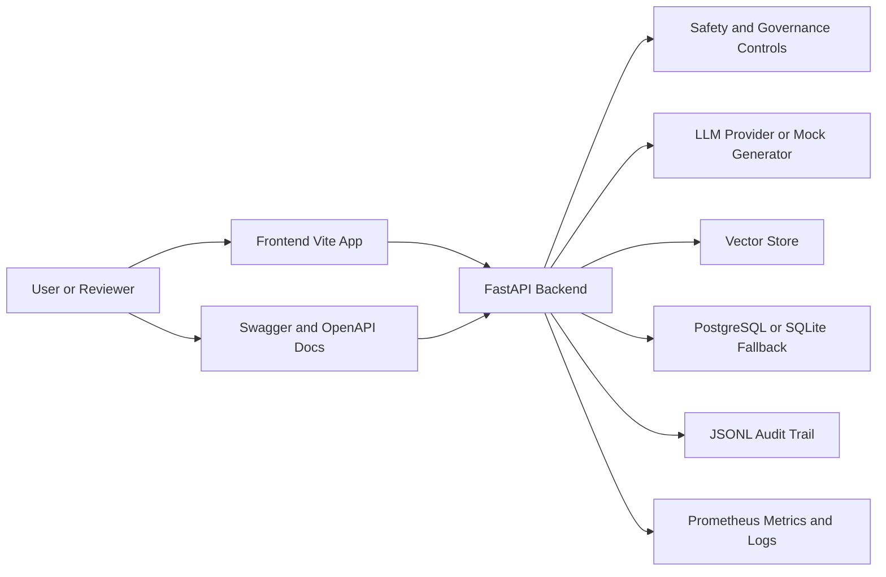

# System Context

## Purpose

This view explains how the end user interacts with the product and which external systems the application depends on.

## Diagram

## What Each Component Does

- **User / Reviewer**: uses the browser or API to inspect the document Q&A workflow and response metadata.
- **Frontend Vite app**: renders the document workspace, answer card, and supporting views used in the demo recording.
- **FastAPI backend**: central orchestration boundary for upload, query, governance, review, audit, and health operations.
- **LLM provider**: optional generation backend selected through configuration. In local demo mode the system can fall back to fake or mock generation.
- **Vector store**: stores chunk embeddings for retrieval. The implementation supports local ChromaDB and PGVector paths.
- **PostgreSQL / SQLite fallback**: stores document metadata and audit-related records when available; local fallback behavior is explicitly supported in services.
- **JSONL audit trail**: append-only record of decisions and advisory actions.
- **Prometheus metrics / logs**: operational visibility for health, readiness, and request behavior.
- **Swagger / OpenAPI docs**: public contract for the backend API.
- **Safety and governance controls**: guardrails, refusal logic, and YAML policy evaluation that prevent unsafe generation.

## Engineering Rationale

The system boundary is intentionally simple: the browser talks to the frontend, the frontend talks to FastAPI, and FastAPI owns all business decisions. That keeps AI behavior, persistence, and auditability inside explicit server-side boundaries instead of burying them in UI code.

## Systems Engineering Principle

This design follows separation of concerns and fail-closed decision making. When retrieval, safety, governance, or generation is not ready, the backend returns a non-trusting outcome instead of a fabricated answer.

## Scalability

- The frontend can remain a thin presentation layer.
- The backend can scale independently from the UI.
- Retrieval can move between ChromaDB and PGVector without changing the user contract.
- The LLM provider is abstracted behind configuration, which makes the system portable across model vendors.

## Maintainability

The system context is stable because the responsibilities are coarse-grained and the API contract is explicit. Changes to retrieval, persistence, or model provider do not require UI rewrites if the response schema remains stable.

## Verification Strategy

- `GET /health`, `GET /health/live`, and `GET /health/ready` validate runtime readiness.
- `GET /metrics` verifies observability wiring.
- OpenAPI and API contract tests verify the external interface.
- Integration and smoke tests verify the backend boots with the configured runtime components.

## Recommendations

- Add a separate frontend container to provide a fully containerized runtime instead of relying on a local Vite server for the UI.
- Keep this file as a concise boundary map for the running application.
