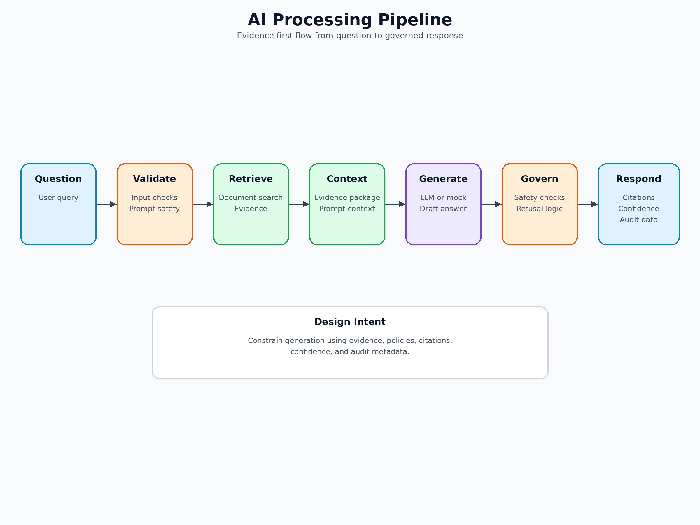
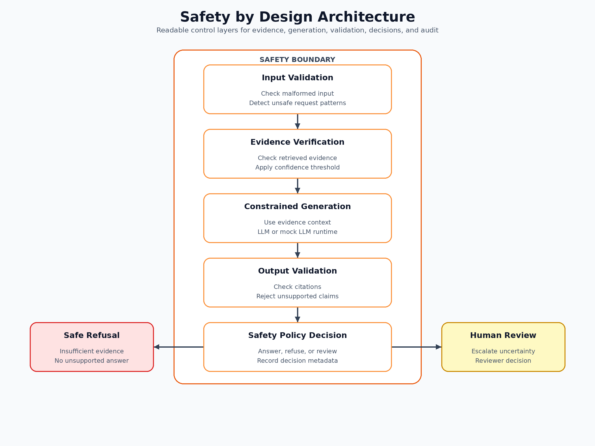

# Safety Architecture

## Dedicated Safety Layer

The safety layer is separated from business logic under `backend/safety/` and orchestrated by `SafetyDecisionEngine`. This keeps hazard controls modular, testable, and injectable.

### AI Processing Pipeline

### Safety Layer

## Why This Improves Safety

- Separates safety logic from retrieval and generation orchestration.
- Makes each control independently testable and traceable.
- Supports deterministic actions: answer, refuse, clarify, insufficient evidence.
- Improves maintainability by keeping rules and validators small and composable.
- Improves auditability by centralizing decisions and reviewer actions.
