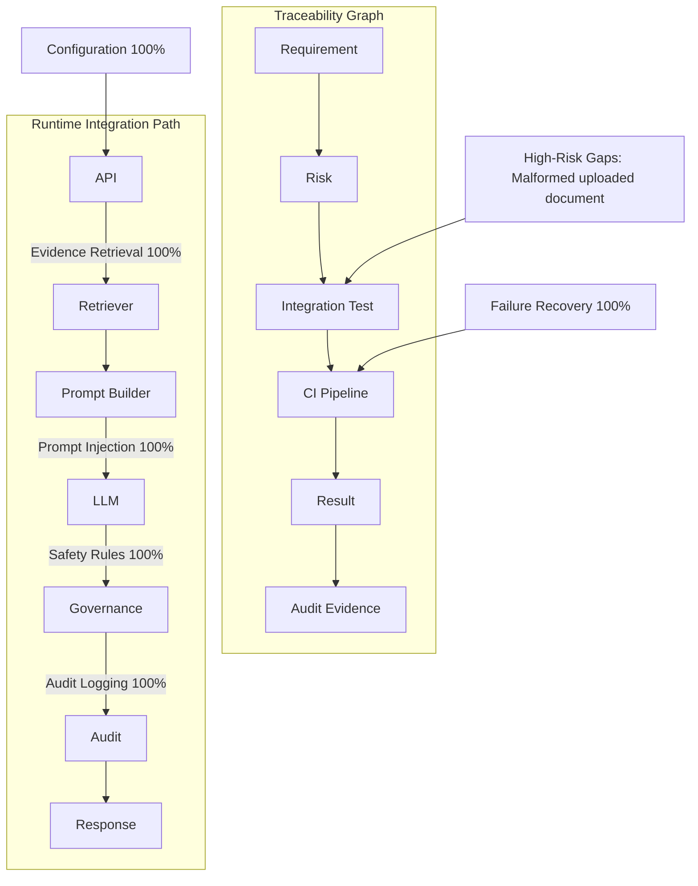

# AI Assisted Integration Testing Report

> AI-generated integration testing output is advisory only and requires human review before use, approval, or execution.

Generated at: 2026-07-10T13:05:18.697633+00:00

## Current Integration Coverage

- Total endpoints discovered: 20
- Endpoints with test signals: 19
- Endpoint coverage ratio: 0.95
- High-risk scenarios covered: 12/13
- High-risk gap ratio: 0.08

## Risk Coverage Score

- Evidence Retrieval
  ██████████ 100% (5 covered, 0 partial, 0 missing)
- Safety Rules
  ██████████ 100% (4 covered, 0 partial, 0 missing)
- Audit Logging
  ██████████ 100% (4 covered, 0 partial, 0 missing)
- Failure Recovery
  ██████████ 100% (4 covered, 0 partial, 0 missing)
- Configuration
  ██████████ 100% (2 covered, 0 partial, 0 missing)
- Document Ingestion
  ██████░░░░ 60% (0 covered, 3 partial, 0 missing)
- Prompt Injection
  ██████████ 100% (3 covered, 0 partial, 0 missing)

## Integration Test Graph

## Missing Scenarios

- Invalid document metadata (medium, partial): Some matching tests exist, but the scenario is not fully evidenced in current test signals.
- Malformed uploaded document (high, partial): Some matching tests exist, but the scenario is not fully evidenced in current test signals.
- Large document uploads (medium, partial): Some matching tests exist, but the scenario is not fully evidenced in current test signals.

## Generated Tests

- No generated draft tests were produced in this run.

## High-Risk Gaps

- Malformed uploaded document: Some matching tests exist, but the scenario is not fully evidenced in current test signals.

## Recommendations

- Generate draft pytest templates for uncovered high-risk scenarios and review them manually before adoption.
- Correlate generated scenarios with audit and CI evidence before promoting them into executable test suites.
- Keep generated drafts under human review and do not auto-approve AI-authored tests in CI.
